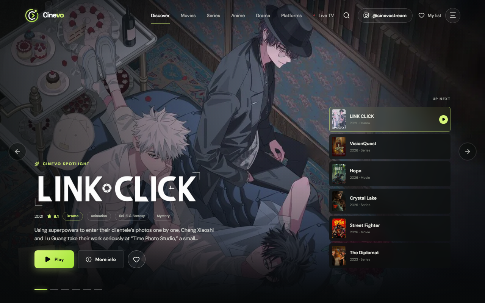
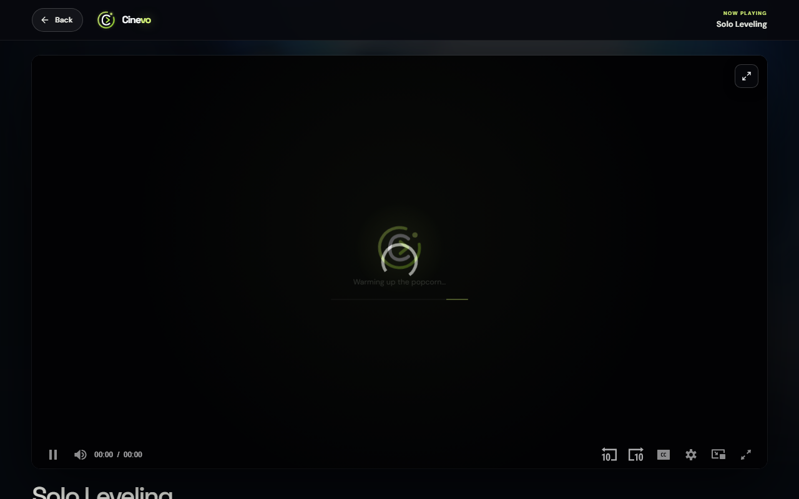
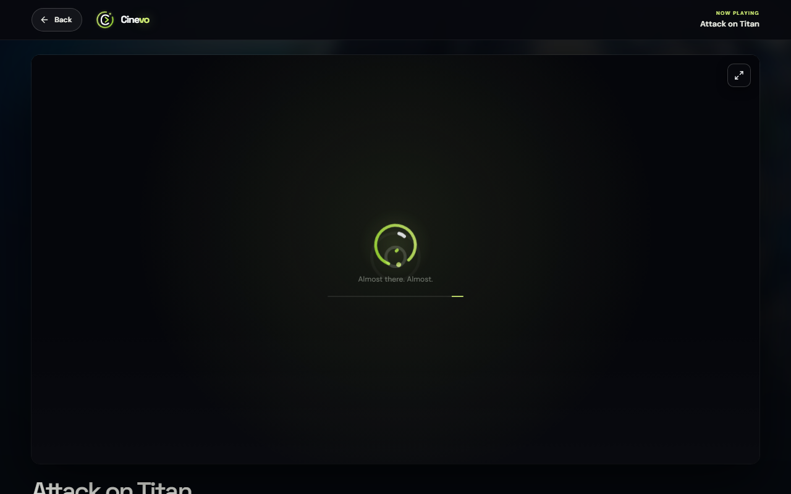
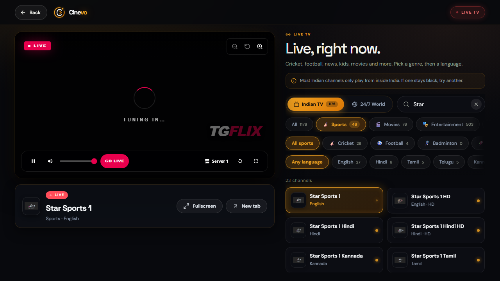
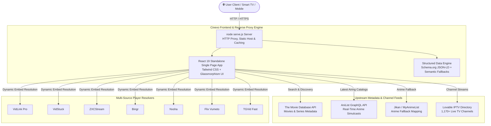

<div align="center">

# 🎬 Cinevo

### **Next-Generation Cinematic Discovery, Multi-Source Streaming & 24/7 Live IPTV Engine**

<p align="center">
  <a href="https://github.com/jaskaran331/cinevo/stargazers"></a>
  <a href="https://github.com/jaskaran331/cinevo/network/members"></a>
  <a href="https://github.com/jaskaran331/cinevo/issues"></a>
  <a href="https://github.com/jaskaran331/cinevo/blob/main/LICENSE"></a>
  <a href="https://nodejs.org/"></a>
  <a href="https://schema.org/"></a>
</p>

<p align="center">
  <b>Cinevo</b> is an ultra-fast, zero-dependency OTT discovery portal and high-definition media player. Featuring an electric lime-green OLED design system, real-time HiAnime release catalog synchronization, automated player HUD auto-hiding, multi-season routing, and 1,170+ global Live TV channels.
</p>

[✨ Key Features](#-features) • [⚡ Quick Start](#-quick-start) • [🏛️ Architecture](#-system-architecture) • [📡 Streaming Engine](#-multi-provider-streaming-resilience) • [🔍 SEO & AI Discovery](#-seo--ai-search-dominance) • [🧪 Testing](#-test--diagnostics)

---

</div>

## 📸 Visual Showcase

<div align="center">
  <table width="100%">
    <tr>
      <td width="50%" align="center">
        <b>Electric Lime Cinematic Discovery</b><br/>
        
      </td>
      <td width="50%" align="center">
        <b>HiAnime Sync & Season Routing</b><br/>
        
      </td>
    </tr>
    <tr>
      <td width="50%" align="center">
        <b>Compact Fast-Jump Season & Episode HUD</b><br/>
        
      </td>
      <td width="50%" align="center">
        <b>24/7 Global IPTV Player with Idle HUD Fade</b><br/>
        
      </td>
    </tr>
  </table>
</div>

---

## 🌟 Features

### ⚡ Electric Lime-Green OLED Aesthetic
- **Signature Visual Identity**: Tailored `#a3e635` / `#84cc16` neon-lime accents set against deep `#06070a` and `#0b0e14` obsidian glass.
- **Glassmorphic Controls**: Backdrop blur filtering (`backdrop-filter: blur(16px)`), luminous border gradients, and responsive micro-interactions.
- **Adaptive Mobile Layout**: 100% responsive on mobile browsers, tablets, desktop monitors, and Smart TVs.

### 🍙 HiAnime Release Catalog Sync & Season Routing
- **Latest Simulcasts Prioritized**: Prioritizes latest seasons and airing episodes over legacy archives (e.g. Solo Leveling Season 2, Bleach TYBW, DanMachi Season 5).
- **AniList & TMDB Multi-Season Parsing**: Maps anime franchises into clean separate seasons and movies with accurate episode counts, eliminating phantom placeholders.
- **Dual Title Localization**: Simultaneous display of Romaji, English, and native Japanese titles with studio credits and status badges.

### 🎛️ Compact Precision Episode & Season Selector
- **Compact HUD**: Streamlined, space-saving selector bars replace cluttered full-page grids.
- **Fast-Jump Navigation**: Direct episode jump inputs (`Go to: [ Ep # ]`) and paginated multi-decade tabs (`1–50`, `51–100`, `101–150+`).
- **Uncapped Episode Depth**: Native support for long-running series with 1,000+ episodes (One Piece, Detective Conan, Naruto Shippuden).

### 📺 24/7 Global Live TV & Sports Streaming
- **1,170+ Channels**: Verified live channels spanning Sports, News, Cinema, Documentary, and International broadcasts.
- **Auto-Hiding Controls**: Player overlay controls and channel bars automatically fade after 2.5 seconds of user inactivity and instantly reappear upon mouse, touch, or key movement.
- **Native iOS & Fullscreen Resilience**: Dual-path engine supporting both native Apple AVPlayer fullscreen (`webkitEnterFullscreen`) and high-z-index pseudo-fullscreen.

### 🌐 High-Uptime Multi-Provider Fallback Engine
- Rotating failover architecture across **VidLink Pro**, **VidStuck**, **ZXCStream**, **Bingr**, **Nxsha**, **Flix Vumeto**, and **TGVid Fast**.
- Seamless fallback selection without restarting playback or losing timestamp context.

---

## ⚡ Quick Start

Cinevo is engineered to be **100% self-contained**. You can clone and run it instantly with zero `npm install` steps required.

### 1. Clone the Repository
```bash
git clone https://github.com/jaskaran331/cinevo.git
cd cinevo
```

### 2. Launch the Development Server
```bash
node serve.js
```

### 3. Open in Browser
Navigate to **`http://localhost:3000`** in your browser.

> [!TIP]
> Cinevo runs on standard Node.js (v18+) without requiring external package installations. All server routing, reverse proxy caching, and MIME handling are handled directly by `serve.js`.

---

## 🏛️ System Architecture



---

## 📡 Multi-Provider Streaming Resilience

| Provider | Supported Formats | Primary Media Types | Autoplay Support | Failover Rank |
|---|---|---|---|---|
| **VidLink Pro** | HLS / Dash / MP4 | Movies, TV Series, Anime | ✅ Yes | Tier 1 (Primary) |
| **VidStuck** | HLS / MP4 | Movies & TV Series | ✅ Yes | Tier 2 |
| **ZXCStream** | HLS Embed | TV Shows & Movies | ✅ Yes | Tier 3 |
| **Bingr** | Adaptive Stream | Global Releases | ✅ Yes | Tier 4 |
| **Nxsha** | Cloud Stream | International TV | ⚠️ Manual | Tier 5 |
| **Flix Vumeto** | Fast Embed | Hollywood & Global | ✅ Yes | Tier 6 |
| **TGVid Fast** | Direct Stream | Direct Files & Specials | ✅ Yes | Tier 7 |

---

## 🔍 SEO & AI Search Dominance

Cinevo is meticulously optimized to achieve top search ranking on **Google**, **Bing**, **Yandex**, **Baidu**, and AI answer engines (**Perplexity**, **ChatGPT Search**, **Claude**, **Gemini**):

- **Structured Data (Schema.org JSON-LD)**: Injected `WebSite` specification with `SearchAction` enabling Google Sitelinks Search Box directly from the search results page, paired with an aggregate 4.9 rating `WebApplication` entity.
- **Universal Crawler Directives (`robots.txt`)**: Explicit crawl directives tailored for `Googlebot`, `Googlebot-Image`, `Googlebot-Video`, `Bingbot`, `Applebot`, `Baiduspider`, `YandexBot`, `PerplexityBot`, `GPTBot`, and `ClaudeBot`.
- **Automated XML Sitemap (`sitemap.xml`)**: Live index of primary application roots, categories (`/movies`, `/series`, `/anime`, `/live`), with change frequencies and priority ratings.
- **PWA Webmanifest (`site.webmanifest`)**: Cross-platform progressive web application declaration for mobile home-screen installation and app store crawling.
- **Semantic Crawler `<noscript>` Fallback**: Comprehensive HTML outline rendering keyword-rich semantic headings, descriptions, and category links for search indexing engines that do not execute complex JavaScript.

---

## 🧪 Test & Diagnostics

Cinevo includes an integrated diagnostic verification suite validating all upstream endpoints, parsers, and build syntaxes:

```bash
node test.js
```

### Verification Coverage:
- ✅ **TMDB Discovery**: Verifies upstream API key connectivity and trending movie feeds.
- ✅ **Live TV Backend**: Confirms availability of all 1,170+ IPTV stream feeds.
- ✅ **AniList GraphQL**: Validates query resolution for real-time anime catalogs.
- ✅ **Standalone Build Integrity**: Tests bundle byte size and absence of raw code leaks.
- ✅ **JavaScript Virtual Machine Syntax**: Runs VM compilation checks on production scripts.
- ✅ **Season Selector Components**: Validates markup existence for compact season selectors.
- ✅ **Route Parser Unit Tests**: Tests pattern matching across movie, series, and anime paths.

---

## 📁 Repository Structure

```
cinevo/
├── assets/
│   └── screenshots/              # High-resolution application screenshots
│       ├── cinevo_home_lime.png
│       ├── cinevo_watch_anime.png
│       ├── cinevo_season_dropdown.png
│       └── cinevo_livetv.png
├── src/
│   ├── config/
│   │   └── constants.js          # API keys, routes & upstream configurations
│   └── services/
│       ├── downloads.js          # Telegram direct file download resolvers
│       ├── livetv.js             # IPTV stream loader & channel categories
│       ├── player.js             # Embed resolver & multi-provider fallback logic
│       └── tmdb.js               # Movie & Series discovery API client
├── index.html                    # Unified React 19 SPA + SEO Structured Data
├── package.json                  # Project manifest and execution scripts
├── robots.txt                    # Search crawler & AI engine directives
├── serve.js                      # High-performance Node.js static & proxy server
├── site.webmanifest              # Progressive Web App (PWA) manifest
├── sitemap.xml                   # Search engine XML sitemap
└── test.js                       # Comprehensive automated testing suite
```

---

## 🛡️ License & Disclaimer

This project is licensed under the **MIT License** — see the [LICENSE](LICENSE) file for details.

*Disclaimer: Cinevo is an educational open-source software project that aggregates publicly accessible third-party APIs and streaming embeds. Cinevo does not host, store, or upload copyrighted video media files to its servers.*

<div align="center">
  <b>Built with precision for film lovers, anime enthusiasts, and sports fans worldwide.</b><br/>
  <sub>⭐ If you find Cinevo useful, consider starring the repository! ⭐</sub>
</div>
